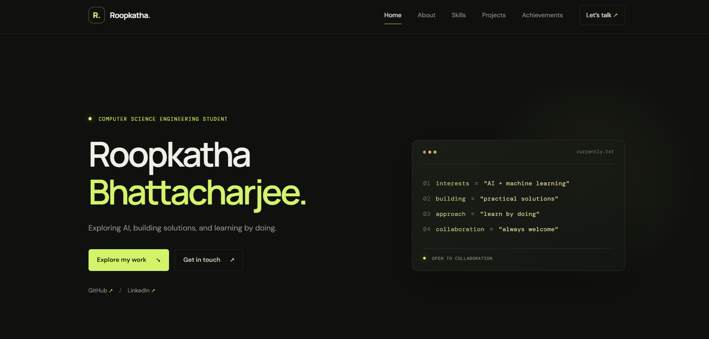
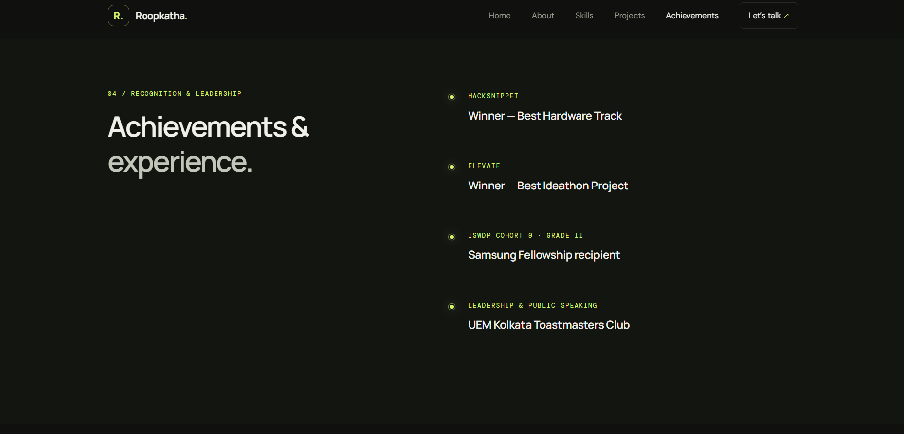
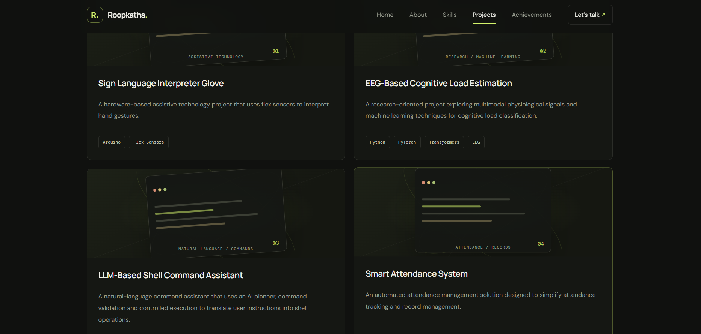
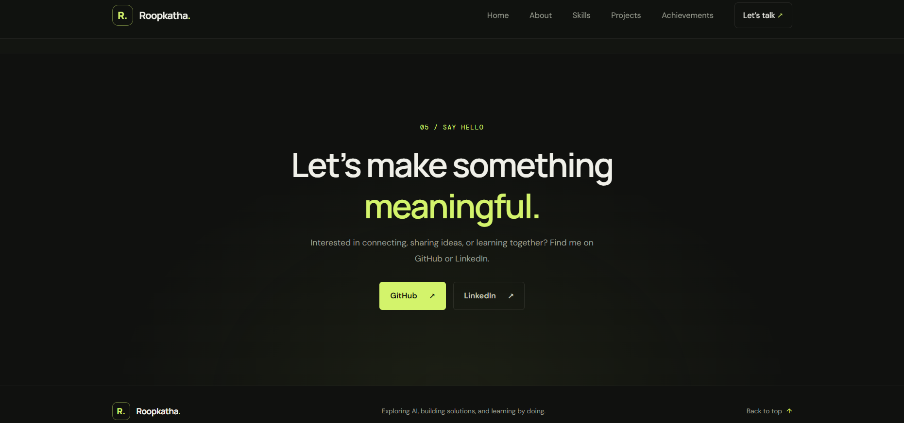

# Personal Developer Portfolio

A responsive, single-page portfolio built with HTML5, CSS3, and vanilla JavaScript. It works as a static site and does not require a backend, a package manager, or a build step.

## Files

- `index.html` contains the accessible page structure, portfolio content, and social/repository links.
- `style.css` contains the visual design, responsive layouts, animations, and reduced-motion styles.
- `script.js` controls the mobile navigation menu and the active navigation state while scrolling.

## Run locally

Open `index.html` in a browser, or serve this folder with any static file server. No dependencies or build commands are required. The selected Google Fonts are optional; system font fallbacks are included.

## Personalize

Update the page title and description, introduction, interests, and project/learning details in `index.html`. Replace the existing social and repository URLs only with profiles or projects you want to share. Add specific technical skills, projects, achievements, experience, or contact details only when you are ready to provide accurate information.

## Screenshots

### 1. Homepage

### 2. Achievements

### 3. Featured Projects

### 4. Contact

## How to Run Locally

1. Clone this repository.
2. Open the `01-github-copilot-app` folder.
3. Open `index.html` in your browser.
4. Alternatively, use the VS Code Live Server extension.

## AI Development Tool

GitHub Copilot was used to assist with application planning, code generation, UI refinement and code review.