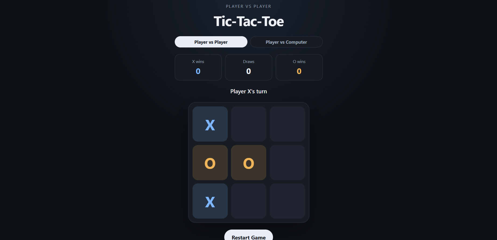
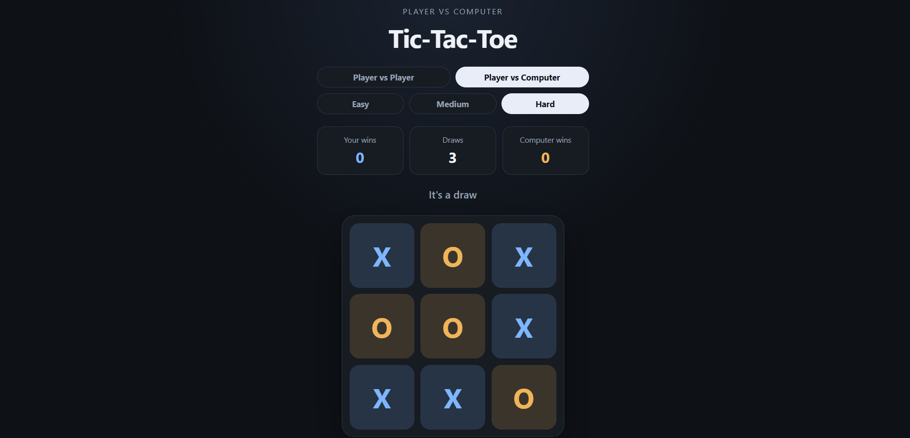

# Tic-Tac-Toe

A Tic-Tac-Toe game in HTML, CSS, and vanilla JavaScript. Open it in a browser. There is no build step and no server.

## Run

1. Open `index.html` in a browser (double-click the file, or drag it into a browser window).
2. Choose **Player vs Player** or **Player vs Computer**.
3. In Player vs Computer, you are X and the computer is O. Pick Easy, Medium, or Hard. The computer moves on its own after a short pause.
4. **Restart Game** clears the board and gives the next game to X. Win and draw totals stay until you reload the page. Switching mode also starts a new round and keeps the scores.

## Modes

- **Player vs Player.** X and O share the device and alternate clicks.
- **Player vs Computer.** You play X. Easy picks a random empty cell. Medium wins if it can, otherwise blocks your win, otherwise picks at random. Hard uses Minimax and plays a perfect game.

## What to test

- In Player vs Player, X and O still alternate, and a filled cell cannot be changed.
- Each row, each column, and both diagonals can win. A full board with no three-in-a-row is a draw.
- After a win or a draw, further cell clicks do nothing.
- Restart during a game does not count as a draw. Restart after a result keeps the scoreboard.
- In Player vs Computer, the status says "Your turn" and "Computer's turn", and the scoreboard says "Your wins" and "Computer wins".
- Cells cannot be clicked while the computer is thinking or after the game ends.
- Easy can play any empty cell. Medium takes a win over a block. Hard cannot be beaten if you play perfectly (the result is a draw).
- The layout stays usable if you narrow the window to a phone width.

## Screenshots

### Player vs Player

### Player vs Computer

